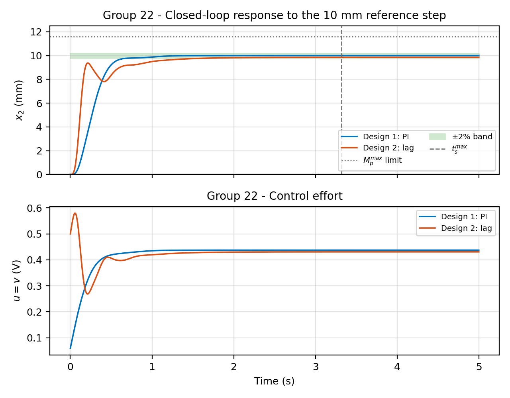
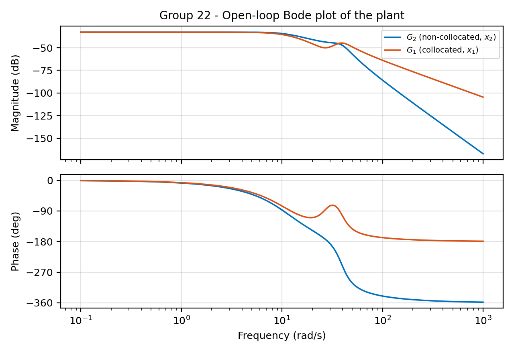
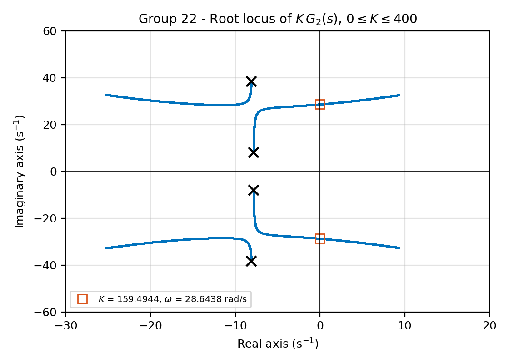
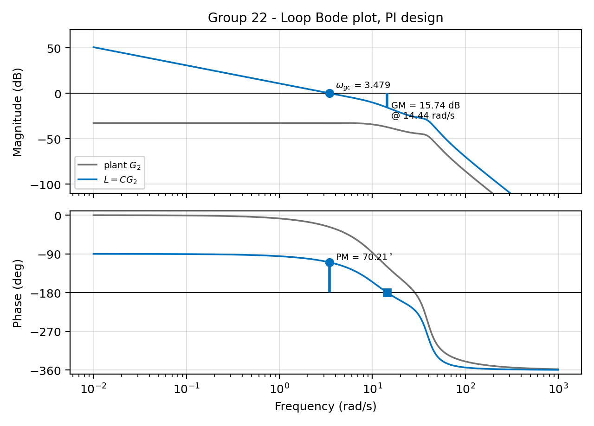
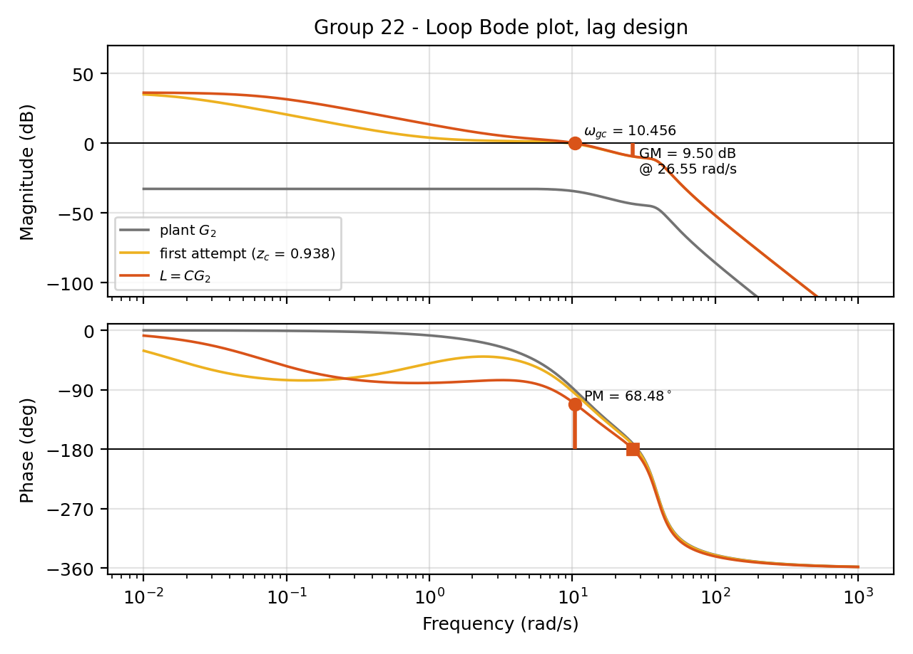
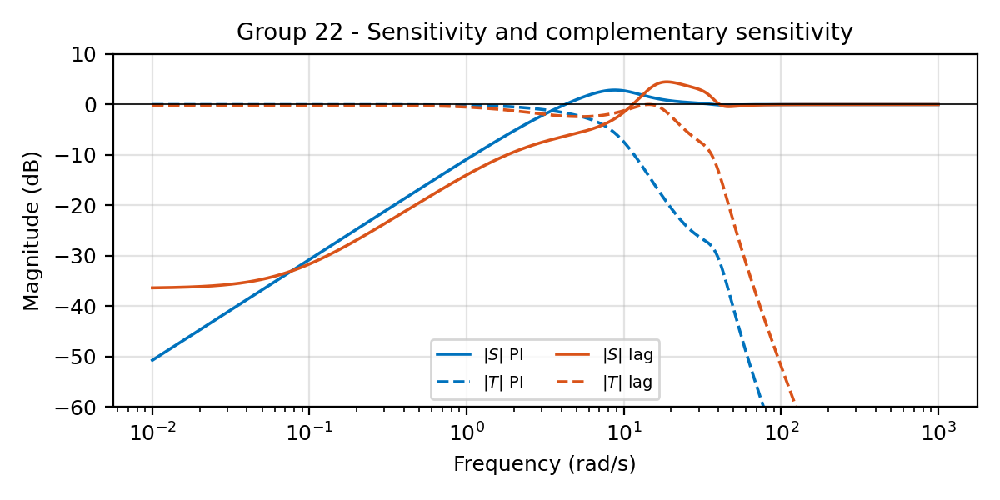
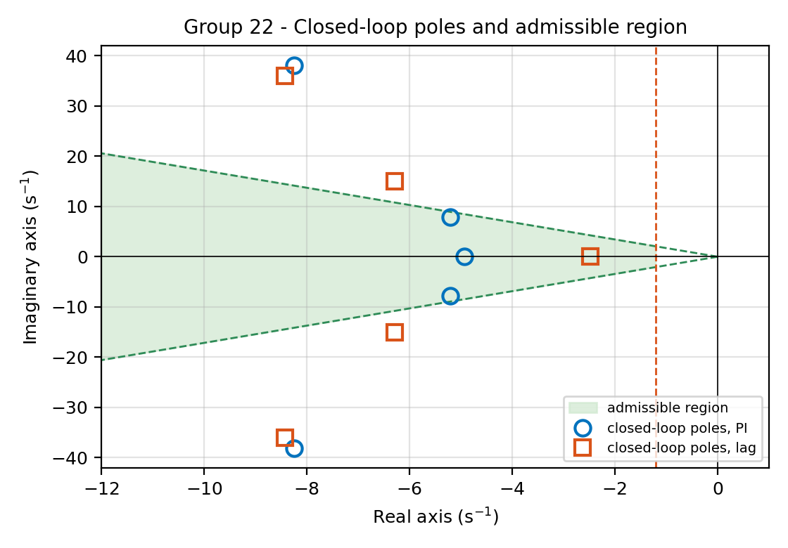

# Classical Control Design for a Two-Mass Rectilinear Plant

Controller design and analysis for an ECP rectilinear (two-mass, spring-damper) plant, done as the AE 308/775 Control Theory course project (Group 22). The plant is fourth-order and the controlled output is the position of the second mass, so the actuator and sensor are non-collocated.

Everything is written in plain Python on top of NumPy and SciPy. The transfer-function algebra, stability margins, sensitivity peak, bandwidth and step-response metrics are implemented from scratch in `ctl.py` rather than taken from a control toolbox.



## Problem

The plant from input voltage `v` to second-mass position `x2` is

```
G2(s) = 7168 / (1.62 s^4 + 51.6 s^3 + 3104.8 s^2 + 42336 s + 313600)
```

with two oscillatory modes: 11.2 rad/s (damping ratio 0.70) and 39.2 rad/s (damping ratio 0.21).

Design targets for a 10 mm reference step:

| Specification | Target |
| --- | --- |
| Peak overshoot | at most 16 % |
| Settling time (2 %) | at most 3.32 s |
| Phase margin | at least 44 deg |
| Gain margin | at least 8 dB |
| Steady-state error | at most 2 % |

## What the code does

1. **Open-loop analysis**: pole-zero map, step response and Bode plot of the collocated and non-collocated transfer functions.
2. **Stability limits**: Routh-Hurwitz array, root locus and Nyquist plot. Proportional gain goes unstable at K = 159.49, crossing the imaginary axis at 28.64 rad/s.
3. **Baseline proportional control**: shows that no single gain meets the specifications. The gain-margin limit caps K at 63.5, while the steady-state error target needs K = 2143.75.
4. **Design 1, PI controller**: built from a Bode construction for a 3.5 rad/s crossover and 70 deg phase margin.
5. **Design 2, lag compensator**: a textbook first attempt, then a retuned zero/pole pair that removes the slow tail.
6. **Validation**: sensitivity and complementary sensitivity, Nyquist plot of the chosen loop, closed-loop poles against the admissible s-plane region, and a dominant-pole prediction compared with the full simulation.

## Results

| Metric | PI: `(6 s + 150) / s` | Lag: `50 (s + 4) / (s + 0.07)` |
| --- | --- | --- |
| Phase margin | 70.2 deg | 68.5 deg |
| Gain margin | 15.7 dB | 9.5 dB |
| Gain crossover | 3.48 rad/s | 10.46 rad/s |
| Overshoot | 0 % | 0 % |
| Settling time (2 %) | 0.80 s | 1.25 s |
| Steady-state error | 0 % | 1.51 % |
| Peak sensitivity | 1.39 | 1.68 |
| Peak control voltage | 0.44 V | 0.58 V |

Both designs meet every specification. The PI controller is the recommended one: it has zero steady-state error, the larger gain margin and the lower sensitivity peak. The lag compensator rises faster (0.11 s against 0.35 s) at the cost of a higher initial voltage and a small residual error.

Every number above is written to `results.json` by the script.

## Running it

```
pip install -r requirements.txt
python main.py
```

This regenerates all 17 figures in `fig/` and rewrites `results.json`. Python 3.10 or newer is needed.

## Files

| File | Purpose |
| --- | --- |
| `main.py` | Top-level script: plant model, analysis, both designs, all figures |
| `ctl.py` | Helper toolkit: transfer-function class, margins, sensitivity peak, bandwidth, step metrics, control effort |
| `results.json` | Every computed number |
| `fig/` | Generated figures |

## Selected figures

| | |
| --- | --- |
|  |  |
|  |  |
|  |  |
